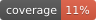

# Dopa Menu

[](https://github.com/dogeared/dopamenu-deepseek/tags)
[](https://github.com/dogeared/dopamenu-deepseek/actions/workflows/ci.yml)
[](https://github.com/dogeared/dopamenu-deepseek/actions/workflows/ci.yml)

A small, opinionated web app for building and using a **dopa-menu**: a menu of intentional
dopamine sources organised into courses.

- **Appetizers** — quick boosts (1–10 minutes)
- **Entrées** — high-impact activities (30+ minutes)
- **Sides** — background stimuli for hard or boring tasks
- **Desserts** — high-dopamine treats, always time-boxed

You order something from the menu, run an optional timer, check in on how you felt before and
after, and keep a private history of what actually helped. No streaks, no scores, no guilt.

Built with:

| Layer | Technology |
| --- | --- |
| Runtime | Java 21 |
| Backend | Spring Boot **4.1.1**, Spring Security 7 |
| UI | Vaadin **25.3.2** (Flow, server-side Java) |
| Auth | Keycloak (OIDC / OAuth 2.0) |
| Database | PostgreSQL 17 + Flyway |
| Packaging | Docker / Docker Compose |

There is **no custom JavaScript**. The countdown timer is a server-side Vaadin poll. All
application styles live in one external stylesheet
(`src/main/resources/META-INF/resources/styles/dopamenu.css`); no inline styles or `<style>`
blocks are generated by the Java views.

---

## What is in the app

- **Home** (`/`) — a public landing page explaining the dopa-menu idea, with a login
  button and a link to the original video. Reachable before and after signing in.
- **Shared menu** (`/m/{token}`) — a public, anonymous view of one person's menu, marked
  `noindex`. Each dish can be ordered in one tap; "Copy this menu" puts the whole thing
  into a signed-in visitor's account.
- **Menu** (`/menu`) — the four courses, seeded with a starter menu, with order buttons and an
  "on the table" banner for the currently running order.
- **Order flow** — mood check-in → countdown (with +5 min and a clear way to stop) → mood
  check-out and optional note. Desserts always carry a timer.
- **History** (`/history`) — last 50 orders, seven-day stats, completion rate, favourite
  course, and average mood lift.
- **Edit menu** (`/manage`) — create, edit, and retire items, plus one rotatable share link.
  Desserts are automatically marked as timer-required.
- **Funnel events** — `share_view`, `menu_copied`, `order_started` and `order_completed` are
  recorded against the share token that caused them, so one link's reach can be read from
  the database.
- **Per-user data** — everything is keyed by the immutable Keycloak subject (`sub`).
- **Soft delete** — retired items are archived, so history keeps its context.

---

## Quick start (app on your machine)

### 1. Start PostgreSQL

```bash
docker compose up -d db
```

This exposes Postgres on host port **5434** (to avoid clashing with a local 5432).

### 2. Start Keycloak

If you already have Keycloak running, skip to
[Using your own Keycloak](#using-your-own-keycloak). Otherwise start the bundled dev instance:

```bash
docker compose -f compose.keycloak.yaml up -d
```

- Keycloak: <http://localhost:8180>
- Admin console: <http://localhost:8180/admin> (`admin` / `admin`)
- Realm: `dopamenu`
- App client: `dopamenu-app`
- Demo user: **`demo`** / **`demo`**

The realm is imported from `keycloak/realm-dopamenu.json` on first start.

The Dopa Menu login theme in `keycloak/themes/dopamenu/` is mounted into the dev container,
and the imported realm already selects it (`loginTheme` is `dopamenu` in
`keycloak/realm-dopamenu.json`). On a Keycloak you run elsewhere, copy that directory into its
`themes/` directory and restart. It extends `keycloak.v2`, so it is CSS-only.

### 3. Run the app

```bash
mvn spring-boot:run
```

Open <http://localhost:8080> and sign in with `demo` / `demo`.

Default local configuration already points at `localhost:8180` for both the browser and
back-channel calls.

> If port 8080 is already taken, use `SERVER_PORT=8081 mvn spring-boot:run` and open
> <http://localhost:8081>. The bundled realm already allows the 8081 redirect URI.

### 4. (Optional) Run the app in Docker too

```bash
docker compose up --build
```

Open <http://localhost:8083>. The app container joins the shared `local-infra`
network, so it reaches Keycloak as `http://keycloak:8080`; the browser still uses
`http://localhost:8180`. The dev reverse proxy in `~/Projects/local-keycloak`
forwards `https://dopamenu.dev.dogeared.dev` to `host.docker.internal:8083`, which
is why the container listens on 8083 rather than 8080.

> **The issuer must match the browser host.** Keycloak derives the token issuer
> from the host of the request that mints it. When `KEYCLOAK_PUBLIC_URL` is a
> proxy host such as `https://auth.dev.dogeared.dev`, the browser reaches
> Keycloak there but the container exchanges the code at `http://keycloak:8080`,
> so the ID token comes back with `iss=http://keycloak:8080/...` and the app
> rejects it with `Invalid credentials`. Pin the realm to the public host:
>
> ```bash
> docker exec keycloak /opt/keycloak/bin/kcadm.sh config credentials \
>   --server http://localhost:8080 --realm master --user admin --password admin
> docker exec keycloak /opt/keycloak/bin/kcadm.sh update realms/dopamenu \
>   -s attributes.frontendUrl=https://auth.dev.dogeared.dev
> ```
>
> `--import-realm` only creates a realm that does not exist yet, so a re-import
> or a fresh volume resets this; rerun the two commands after either. With the
> default `KEYCLOAK_PUBLIC_URL=http://localhost:8180` the issuer already matches
> and no pin is needed.

If `local-infra` does not exist yet, create it once with
`docker network create local-infra`.

For the public host, the realm-hygiene steps and the off-network smoke test, see
[`docs/deploy.md`](docs/deploy.md).

> If you change `APP_PORT`, update the client's redirect URIs in Keycloak accordingly
> (`http://localhost:<port>/login/oauth2/code/keycloak`).

---

## Using your own Keycloak

You do not need the bundled Keycloak. With your existing instance:

1. Create a realm named `dopamenu` (or set `KEYCLOAK_REALM`).
2. Create a **confidential** OpenID Connect client:
   - Client ID: `dopamenu-app` (or set `KEYCLOAK_CLIENT_ID`)
   - Client authentication: **on**
   - Standard flow: **on**
   - Valid redirect URIs: `http://localhost:8080/login/oauth2/code/keycloak`
   - Web origins: `http://localhost:8080`
   - Valid post-logout redirect URIs: `http://localhost:8080` (or use `+`)
   - Copy the client secret into `KEYCLOAK_CLIENT_SECRET`
3. Create a user, or reuse an existing one.

The app resolves the Keycloak endpoint without OIDC discovery, so you can (and often must)
split the URL used by the browser from the URL used inside Docker:

```bash
KEYCLOAK_PUBLIC_URL=http://localhost:8180      # browser-facing URL, also the "iss" expected in tokens
KEYCLOAK_INTERNAL_URL=http://keycloak:8080      # back-channel URL used by the app container
```

When running the app on your machine, set both to your Keycloak URL.

If you import a realm export outside local development, use
`keycloak/realm-dopamenu.production.json`. `keycloak/realm-dopamenu.json` is the
development realm (`demo` user, `sslRequired: none`, localhost redirect URIs).

---

## Production build and deploy

The image is the deployable artifact. It builds the Vaadin frontend bundle in the
production profile, runs as an unprivileged user, listens on `8080`, and serves
`/actuator/health` for a platform health check.

### 1. Build the image

```bash
mvn -Pproduction verify        # tests + coverage gate; needs Docker for Testcontainers
docker build -t dopamenu:0.1.4 .
```

`mvn -Pproduction package` produces the same jar without the tests when CI has
already run them. The Dockerfile builds inside the image and copies
`target/dopamenu-*.jar` to `/app/app.jar`, so tag the image with the version in
`pom.xml`.

### 2. Run the container

The app needs a Postgres 17 database and the Keycloak settings in sections 3–6:

```yaml
services:
  app:
    image: dopamenu:0.1.4
    restart: unless-stopped
    ports: ["8080:8080"]      # omit when the ingress joins this network instead
    environment:
      DB_URL: jdbc:postgresql://db:5432/dopamenu
      DB_USER: dopamenu
      DB_PASSWORD: <secret>
      KEYCLOAK_PUBLIC_URL: https://auth.<your-domain>
      KEYCLOAK_INTERNAL_URL: http://keycloak:8080
      KEYCLOAK_REALM: dopamenu
      KEYCLOAK_CLIENT_ID: dopamenu-app
      KEYCLOAK_CLIENT_SECRET: <the client secret>
```

- Flyway runs the migrations on boot and JPA runs in `validate` mode, so a schema
  that does not match the migrations stops the container instead of drifting.
- `KEYCLOAK_PUBLIC_URL` is the browser-facing base URL **and** the issuer the app
  expects in every ID token. `KEYCLOAK_INTERNAL_URL` is the container-to-container
  URL used for token exchange and JWKS; it does not have to match.
- Keep secrets in the orchestrator's secret store or an untracked env file, never
  in a committed `.env`.
- TLS terminates at the ingress, which must forward `X-Forwarded-Proto` and
  `X-Forwarded-Host`. Spring's `forward-headers-strategy: framework` uses them to
  build the OAuth redirect URI, so a missing header sends the callback to
  `http://` or to the container hostname.

For the ingress route, the shared database, and the two-repo contract, see
[`docs/deploy.md`](docs/deploy.md).

### 3. Create the production realm

Import `keycloak/realm-dopamenu.production.json` (open Create realm and choose
Resource file, or run `kcadm create realms -f`). If a `dopamenu` realm already
exists, delete it first; Keycloak does not overwrite an existing realm on
import. It is the production artifact. It has no `demo` user, sets
`sslRequired` to `external`, allows only the public redirect URIs, pins the
Frontend URL to `https://auth.dogeared.dev`, and turns email verification on.
Keycloak generates the client secret on import; copy it from the
`dopamenu-app` client's Credentials tab. Configure the realm's Email settings
before the first real signup, because verification fails closed until mail
works.

The manual equivalent, if you prefer to build the realm in the console, is
below. The checked-in `keycloak/realm-dopamenu.json` is the development realm;
do not import it here.

In Realm settings, open General:

- Realm name `dopamenu` (or set `KEYCLOAK_REALM`).
- Frontend URL `https://auth.<your-domain>` (the realm attribute `frontendUrl`).
  This pins the issuer, so the back-channel exchange cannot mint the internal
  hostname as `iss`.
- Require SSL `external`.

In Realm settings, open Login:

- User registration **on**. The app's "Create account" call to action and the
  `/register` route both depend on it.
- Duplicate emails **off**, login with email **on**.
- Require email verification **on**, described in section 6.

In Realm settings, open Email. Fill in the SMTP host, port, credentials, and a
From address, then use **Test connection**. SMTP is configured per realm, so a
realm that already sends mail keeps its own settings; the `dopamenu` realm
needs its own copy.

### 4. Create the client

In Clients, choose Create client:

- Client type **OpenID Connect**, client ID `dopamenu-app`.
- **Client authentication on** (confidential), **Standard flow on**, direct access
  grants off, service accounts off.
- Valid redirect URI: `https://dopamenu.<your-domain>/login/oauth2/code/keycloak`.
  Use that exact Spring callback path and keep it as the only redirect URI, with
  no localhost or wildcard entries.
- Valid post-logout redirect URIs: `https://dopamenu.<your-domain>/*`.
- Web origins: `https://dopamenu.<your-domain>`.
- On the Advanced tab, set Proof Key for Code Exchange Code Challenge Method to
  `S256`.

Copy the secret from the client's Credentials tab into
`KEYCLOAK_CLIENT_SECRET`, and rotate it there if it has ever been committed.

### 5. Install the login theme

Copy the theme into the Keycloak instance that serves the realm:

```bash
cp -R keycloak/themes/dopamenu <keycloak-home>/themes/
```

Then open Realm settings, go to Themes, set Login theme to `dopamenu`, and
restart Keycloak so it rescans the theme directory. A container can mount the
directory read-only instead of copying it, and an optimized image must run
`kc.sh build` before `kc.sh start --optimized` so the theme is baked in:

```yaml
volumes:
  - ./keycloak/themes/dopamenu:/opt/keycloak/themes/dopamenu:ro
```

The theme extends `keycloak.v2` and is CSS-only, so it carries no templates to
rebase on a Keycloak upgrade. There is no custom email theme; verification and
password-reset messages use Keycloak's stock templates.

### 6. Require email verification

Turn on **Require email verification** under Realm settings, then Login (the
realm attribute `verifyEmail`). With SMTP configured, Keycloak sends the
verification message at registration and blocks the OIDC flow until the address
is confirmed.
The app needs no extra code and has no "unverified" state to render.

- The verification link is built from the realm's Frontend URL. If that points at
  anything but the public auth host, new users receive a dead link.
- Turn on **Forgot password** (`resetPasswordAllowed`) as well, so a locked-out
  user can recover without an operator.
- Use a real mailbox on the first pass. Register an account, wait for the
  message, click the link, and only then sign in. A realm with verification on
  and SMTP misconfigured fails closed — registration succeeds and no mail
  arrives.

### 7. Verify the deploy

```bash
curl -sI https://dopamenu.<your-domain>/                 # 200
curl -s  https://dopamenu.<your-domain>/actuator/health  # {"status":"UP"}
curl -sI https://dopamenu.<your-domain>/menu             # 302 to the Keycloak auth endpoint
```

Then create an account through `/register` with a real address, confirm the
verification email arrives and works, and sign in. [`docs/deploy.md`](docs/deploy.md)
has the full off-network smoke test, including the share-link funnel and the
database queries.

---

## Configuration

| Variable | Default | Purpose |
| --- | --- | --- |
| `DB_URL` | `jdbc:postgresql://localhost:5434/dopamenu` | JDBC URL |
| `DB_USER` | `dopamenu` | Database user |
| `DB_PASSWORD` | `dopamenu` | Database password |
| `SERVER_PORT` | `8080` | App port (local runs) |
| `KEYCLOAK_PUBLIC_URL` | `http://localhost:8180` | Browser-facing Keycloak base URL |
| `KEYCLOAK_INTERNAL_URL` | `http://keycloak:8080` in Compose, `http://localhost:8180` when run from the host | Back-channel Keycloak base URL |
| `KEYCLOAK_REALM` | `dopamenu` | Realm name |
| `KEYCLOAK_CLIENT_ID` | `dopamenu-app` | OIDC client id |
| `KEYCLOAK_CLIENT_SECRET` | `dopamenu-secret` | OIDC client secret |
| `APP_PORT` | `8083` | Host port for the app in Compose |
| `DB_PORT` | `5434` | Host port for Postgres in Compose |
| `KEYCLOAK_PORT` | `8180` | Host port for bundled Keycloak |

See `.env.example`. Docker Compose reads `.env` automatically.

---

## Development

```bash
mvn test                 # unit tests + coverage report
mvn verify               # all tests + the 90% line-coverage gate
mvn spring-boot:run      # dev mode with hot reload
mvn -Pproduction package # production build (Vaadin frontend bundle)
```

`mvn verify` includes one HTTP-level test (`PublicRouteHttpTest`) that starts the
application against a Testcontainers Postgres, so it needs a running Docker daemon.
`mvn test` runs the same test class and therefore needs Docker too.

The JaCoCo HTML report is written to `target/site/jacoco/index.html`. Only
framework wiring (`SecurityConfig`, `AppShell`, `DopaMenuApplication`) is excluded
from the coverage gate; domain, service, configuration, and the Vaadin UI
components are all measured.

The production build writes `target/dopamenu-0.1.4.jar`; the Dockerfile uses it in a
multi-stage build.

### Project layout

```
src/main/java/com/example/dopamenu/
  config/        security + Keycloak client registration
  domain/        Course, MenuItem, MenuOrder, MenuShare, MenuEvent (JPA entities)
  repository/    Spring Data repositories
  service/       menu, order, share and event services, plus pure stats calculation
  ui/            Vaadin views, dialogs and shared components
src/main/resources/
  application.yml
  db/migration/  Flyway migrations
  META-INF/resources/styles/dopamenu.css
keycloak/        importable dev realm + login theme
docs/            designs, deploy contract, experiment protocol
compose.yaml     app + Postgres
compose.keycloak.yaml  optional dev Keycloak
```

### Data model

- `menu_item` — owned by `owner_sub`, one of four courses, duration, dopamine strength,
  timer flag, archived flag, and the share token it was copied through (`source_share_token`,
  null for items the owner made).
- `menu_order` — a snapshot of the ordered item (title + course), start/end timestamps,
  planned minutes, status (`ACTIVE`, `COMPLETED`, `ABANDONED`), mood before/after, note, and
  the share token that led to it.
- `menu_share` — one active share link per owner: token, author display name, created and
  revoked timestamps. A partial unique index enforces the one-active-link rule.
- `menu_event` — the funnel: `share_view`, `menu_copied`, `order_started`,
  `order_completed`, with the token, owner, order id and referrer. Kept unbounded
  during the experiment; see `docs/experiments/monetization-validation.md` for the
  prune statement.

Statistics are calculated in `OrderStats` from the orders in the last seven days. `ACTIVE`
orders do not count toward completion rate.

### Security notes

- All routes require an authenticated Keycloak user, except the landing page (`/`), the
  share page (`/m/**`), `/login`, `/register`, `/actuator/health`, the favicon, and the static
  stylesheet/VAADIN assets.
- The share page carries `X-Robots-Tag: noindex` from a narrow servlet filter mapped to
  `/m/*`, so shared menus stay out of search results while the landing page does not.
- CSRF, logout, and Vaadin's internal request handling are configured through
  `VaadinSecurityConfigurer`.
- Logout is RP-initiated (Keycloak ends the SSO session) and returns to the app.
- ID-token issuer validation stays enabled. The public/internal URL split only affects which
  host is used for token exchange and JWKS.
- The committed database password, client secret, and Keycloak admin/demo credentials are for
  local development only. Replace them (and restore stricter `sslRequired` settings) before
  exposing the stack anywhere.

---

## Ideas for later

- Shared/household menus and a "what should I do?" shuffle.
- Timer notifications that survive a closed browser tab.
- Weekly reflection export.
- Optional "dopamine debt" view comparing quick hits with entrées.
